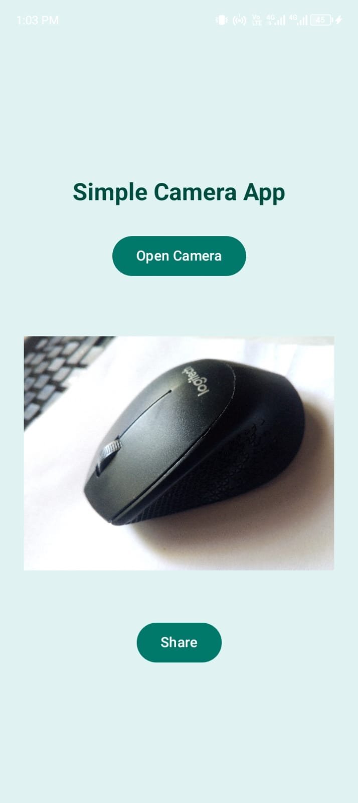
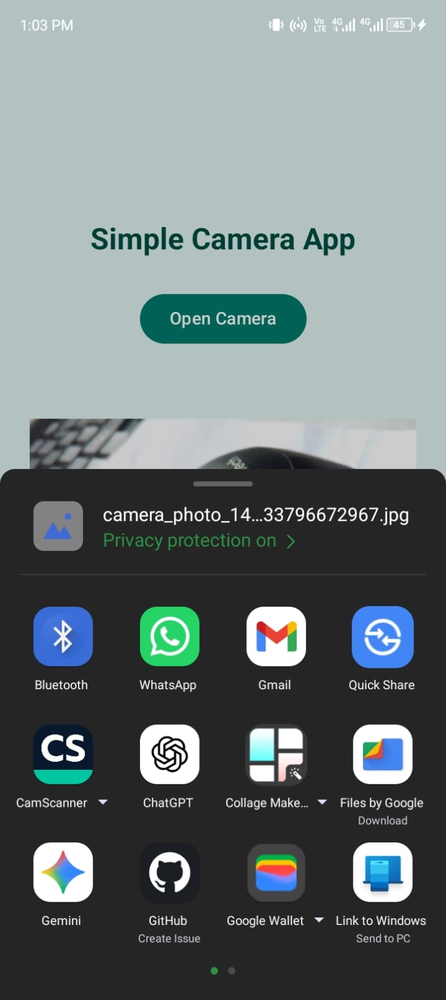

# SnapShare – Simple Camera App

A simple Android app built with **Kotlin** and **Jetpack Compose** for the Mobile Application Development assignment.

## Features
- Open the device camera
- Capture a photograph
- Display the captured photo inside the app
- Share the photo through the Android system share sheet (WhatsApp, Bluetooth, etc.)

## Screenshots

<p align="center">
  
  
  
</p>

## How it works
- **Camera:** uses the `TakePicture` activity result contract to launch the system camera.
- **FileProvider:** the photo is saved in the app's cache (`cache/images/`) and exposed through a `content://` Uri, configured in `res/xml/file_paths.xml`.
- **Display:** the saved photo is decoded into a bitmap and shown with Compose's `Image`.
- **Sharing:** an `Intent.ACTION_SEND` with the photo Uri is wrapped in `Intent.createChooser()` to open Android's share sheet.

## Tech stack
- Kotlin
- Jetpack Compose (Material 3)
- Android Studio

## How to run
1. Clone this repository.
2. Open the project in Android Studio and wait for Gradle sync.
3. Run on a physical device or an emulator with a camera.
4. Tap **Open Camera**, take a photo, then tap **Share**.

## Project structure
```
SnapShare/
├── app/src/main/
│   ├── java/com/example/snapshare/MainActivity.kt
│   ├── res/xml/file_paths.xml
│   └── AndroidManifest.xml
├── screenshots/       
└── README.md
```